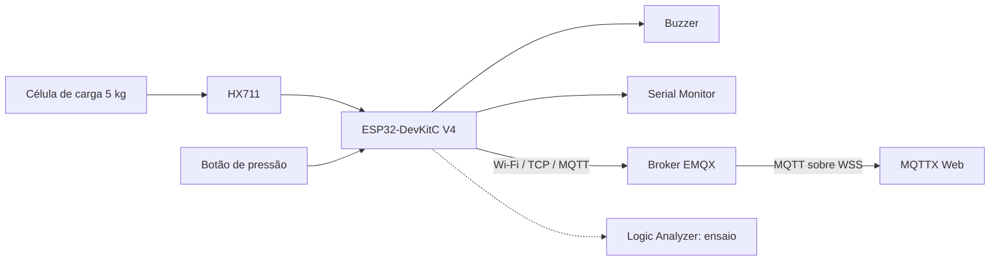

# Monitoramento Inteligente da Ingestão de Água

Projeto acadêmico de Internet das Coisas (IoT) desenvolvido na Universidade Presbiteriana Mackenzie por Giuliana Dias Guimarães e André Luis de Oliveira. O protótipo estima a quantidade de água consumida e restante em uma garrafa a partir da variação de massa, emite um alerta sonoro de nível baixo e disponibiliza os dados remotamente por MQTT. A proposta está relacionada ao ODS 3 — Saúde e Bem-Estar.

A implementação foi desenvolvida em C++ com o framework Arduino para ESP32 e validada no simulador Wokwi. Não foi realizada montagem física.

## Funcionalidades

- Aquisição da massa por meio da célula de carga e do HX711.
- Tara inicial e início de sessão por botão de pressão.
- Estimativa do volume restante e do consumo acumulado.
- Detecção de reabastecimento sem zerar o consumo acumulado.
- Alerta sonoro quando restam 100 mL ou menos.
- Publicação de telemetria e eventos por Wi-Fi e MQTT.
- Monitoramento pelo Serial Monitor e pelo MQTTX Web.
- Instrumentação do tempo de resposta elétrico do buzzer com analisador lógico.

## Arquitetura



O ESP32 integra o módulo Wi-Fi, sem necessidade de uma interface serial-USB intermediária para a comunicação MQTT.

## Hardware e montagem

| Componente | Quantidade | Função |
|---|---:|---|
| ESP32-DevKitC V4 | 1 | Processamento e comunicação Wi-Fi |
| Célula de carga de 5 kg + HX711 | 1 conjunto | Aquisição da massa (modelo integrado no Wokwi) |
| Botão de pressão de 6 mm | 1 | Início de nova sessão |
| Buzzer piezoelétrico virtual | 1 | Alerta sonoro |
| Logic Analyzer virtual | 1 | Instrumentação dos ensaios do atuador |

### Pinagem da simulação

| Componente | Terminal | ESP32 |
|---|---|---|
| HX711 | VCC | 5V |
| HX711 | GND | GND.2 |
| HX711 | DT | GPIO16 |
| HX711 | SCK | GPIO4 |
| Botão | 1.l | GPIO14 |
| Botão | 2.l | GND.2 |
| Buzzer | 2 (+) | GPIO25 |
| Buzzer | 1 (−) | GND.1 |
| Logic Analyzer | D0 | GPIO26 |
| Logic Analyzer | D1 | GPIO25 |
| Logic Analyzer | GND | GND.1 |

O botão utiliza o pull-up interno do ESP32. A ligação direta do buzzer e a alimentação de 5 V do HX711 correspondem ao modelo virtual. Para a montagem física proposta, prevê-se buzzer magnético de 5 V com transistor BC548, resistor de 1 kΩ e diodo 1N4148; é necessário validar a compatibilidade elétrica e os níveis lógicos do HX711 antes da montagem. A base de pesagem e a garrafa são conceituais: não foram fabricadas peças ou caixas por impressão 3D.

## Software e dependências

- `sketch.ino`: firmware em C++ para o ESP32.
- `diagram.json`: componentes e conexões do circuito Wokwi.
- `libraries.txt`: dependências da simulação.

Bibliotecas utilizadas no Wokwi:

```text
HX711
EspMQTTClientFork
```

A EspMQTTClientFork deriva da biblioteca EspMQTTClient e utiliza PubSubClient como dependência. O cabeçalho no firmware permanece `EspMQTTClient.h`.

### Organização do código

| Função | Responsabilidade |
|---|---|
| `setup()` | Configurar GPIOs, executar a tara e preparar o MQTT |
| `loop()` | Gerenciar a conexão, ler o botão e o sensor, calcular volumes e controlar o buzzer |
| `publicarTelemetria()` | Serializar o estado e o evento em JSON e publicar no tópico MQTT |
| `onConnectionEstablished()` | Registrar a conexão e publicar o estado atual em caso de sessão ativa |

O GPIO26 marca o instante imediatamente anterior ao comando `tone()` para os ensaios com analisador lógico.

## Como reproduzir no Wokwi

1. Acesse [Wokwi](https://wokwi.com/) e crie um projeto ESP32-DevKitC V4 com Arduino.
2. Copie os arquivos `sketch.ino`, `diagram.json` e `libraries.txt` deste repositório para o projeto (após sua publicação).
3. Deixe o controle de carga do HX711 no mínimo e inicie a simulação para executar a tara.
4. Aguarde a confirmação da conexão MQTT no Serial Monitor.
5. Ajuste a carga para aproximadamente 1.200 g e pressione o botão verde para iniciar uma sessão.
6. Diminua a massa para simular o consumo e aguarde a estabilização; aumente a massa para simular o reabastecimento.
7. Para testar o alerta, reduza a massa para aproximadamente 250 g. Aumente-a para aproximadamente 700 g para desligar o buzzer.

### Parâmetros de referência

| Parâmetro | Valor |
|---|---:|
| Capacidade da garrafa | 1.000 mL |
| Massa da garrafa vazia | 200 g |
| Massa da garrafa cheia | 1.200 g |
| Limite de alerta | 100 mL |
| Fator de calibração virtual | 420 unidades brutas/kg |
| Tara | Média de 20 amostras |
| Leitura | Média de 10 amostras |
| Estabilidade | 3 leituras próximas, tolerância de 15 g |
| Limiar de variação | 20 mL |
| Frequência do buzzer | 2.500 Hz |

A massa em gramas é estimada por `(leitura - offset) * 1000 / 420`. O volume restante é calculado subtraindo 200 g da massa e limitando o resultado entre 0 e 1.000 mL. Uma redução de pelo menos 20 mL aumenta o consumo acumulado; um aumento de pelo menos 20 mL atualiza a referência sem zerar o consumo. O cálculo usa a aproximação de 1 g/mL para a densidade da água. O fator de calibração é específico da simulação.

## Comunicação MQTT

O ESP32 publica mensagens MQTT 3.1.1 sobre TCP/IP. O MQTTX Web recebe os dados como assinante via WebSocket seguro.

| Configuração | ESP32 | MQTTX Web |
|---|---|---|
| Rede Wi-Fi | Wokwi-GUEST (sem senha) | Rede do computador |
| Broker | broker.emqx.io | broker.emqx.io |
| Transporte | MQTT/TCP | WSS |
| Porta | 1883 | 8084 |
| Caminho WebSocket | — | /mqtt |
| QoS | 0 | 0 |
| Usuário/senha | Vazio | Vazio |

Tópico original dos ensaios:

```text
mackenzie/monitoramento-agua/prototipo-7319/telemetria
```

Para reproduzir o projeto, altere o identificador do cliente e o tópico no firmware para valores próprios e exclusivos, e use o mesmo tópico no assinante. Isso evita conflitos com outras instâncias.

No [MQTTX Web](https://mqttx.app/web-client), crie a conexão com os parâmetros acima, utilize um Client ID diferente do ESP32 e inscreva-se no tópico com QoS 0.

### Formato das mensagens

Exemplo ilustrativo de telemetria:

```json
{
  "evento": "telemetria",
  "massa_atual_g": 700.0,
  "agua_consumida_acumulada_ml": 500,
  "agua_restante_ml": 500,
  "buzzer_ativo": false
}
```

| Evento | Significado |
|---|---|
| `nova_medicao` | Início de sessão |
| `consumo` | Redução de volume identificada |
| `reabastecimento` | Aumento de volume identificado |
| `alerta_agua_baixa` | Ativação do buzzer |
| `nivel_normalizado` | Desativação do buzzer |
| `telemetria` | Publicação periódica |
| `reconexao` | Estado atual após conexão com sessão ativa |

A telemetria é programada para intervalos de 5 segundos, condicionada à execução do ciclo de leitura estável e à conexão ativa. Os eventos são publicados quando detectados. A comunicação é de monitoramento: não há recebimento de comandos remotos implementado.

## Resultados dos ensaios

Os testes funcionais demonstraram a estimativa de consumo, detecção de reabastecimento, alerta sonoro e recepção de mensagens no MQTTX. Em um ensaio, o consumo acumulado permaneceu em 879 mL durante o reabastecimento e atingiu 1.238 mL após novos consumos.

### Tempos de resposta

| Medição | Buzzer (ms) | HX711 até MQTTX (ms) |
|---:|---:|---:|
| 1 | 1,887 | 833,33 (consumo) |
| 2 | 1,084 | 800,00 (reabastecimento) |
| 3 | 1,085 | 400,00 (consumo) |
| 4 | 1,727 | 466,67 (reabastecimento) |
| **Média** | **1,446** | **625,00** |

O buzzer foi avaliado pela diferença entre a borda de subida do marcador GPIO26 e a primeira borda de subida do sinal GPIO25, registrada em arquivos VCD. O resultado é uma latência elétrica simulada, não acústica. O HX711 foi avaliado por análise de gravações de tela a 30 FPS, desde a exibição da detecção de consumo ou reabastecimento até a exibição do evento correspondente no MQTTX. A resolução temporal é de aproximadamente 33,33 ms; a medida inclui atualização das interfaces e não contempla a estabilização anterior à detecção. O ensaio complementar de latência do botão não foi realizado.

## Limitações e melhorias futuras

- A solução não distingue ingestão de água de derramamento ou retirada da garrafa da base.
- O modelo virtual não substitui a calibração e a validação em hardware real.
- O broker é público; o ESP32 usa comunicação sem TLS na porta 1883. Utilize apenas dados fictícios.
- O QoS 0 não garante a entrega de todas as mensagens; eventos não enviados durante desconexões não são armazenados para retransmissão.
- Melhorias previstas: detecção de retirada da garrafa, calibração física, armazenamento de eventos, broker privado com autenticação e TLS e painel de acompanhamento do histórico.

## Referências técnicas

- [Wokwi — ESP32 WiFi Networking](https://docs.wokwi.com/guides/esp32-wifi)
- [Wokwi — HX711](https://docs.wokwi.com/parts/wokwi-hx711)
- [Wokwi — Logic Analyzer](https://docs.wokwi.com/guides/logic-analyzer)
- [Espressif — ESP32-DevKitC V4](https://docs.espressif.com/projects/esp-dev-kits/en/latest/esp32/esp32-devkitc/user_guide.html)
- [HX711 — Bogde](https://github.com/bogde/HX711)
- [EspMQTTClient — Patrick Lapointe](https://github.com/plapointe6/EspMQTTClient)
- [EspMQTTClientFork](https://github.com/zimbora/EspMQTTClient)
- [OASIS — MQTT 3.1.1](https://docs.oasis-open.org/mqtt/mqtt/v3.1.1/os/mqtt-v3.1.1-os.html)
- [EMQX — Broker público](https://www.emqx.com/en/mqtt/public-mqtt5-broker)

## Autores

Giuliana Dias Guimarães e André Luis de Oliveira — Universidade Presbiteriana Mackenzie.
